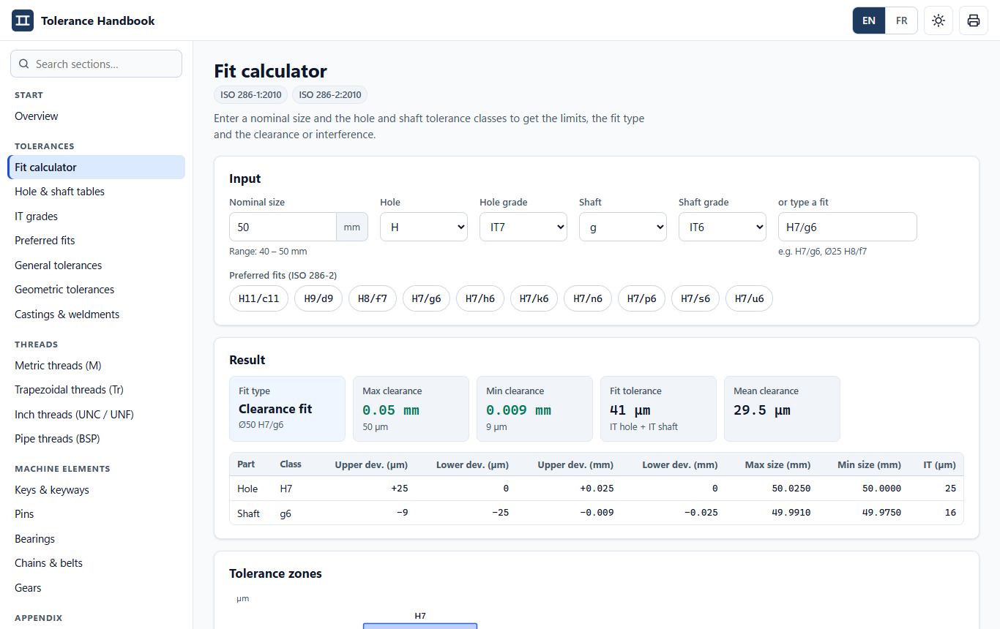
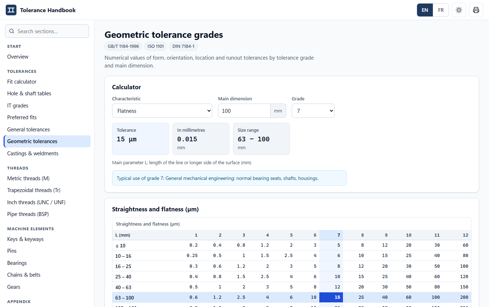
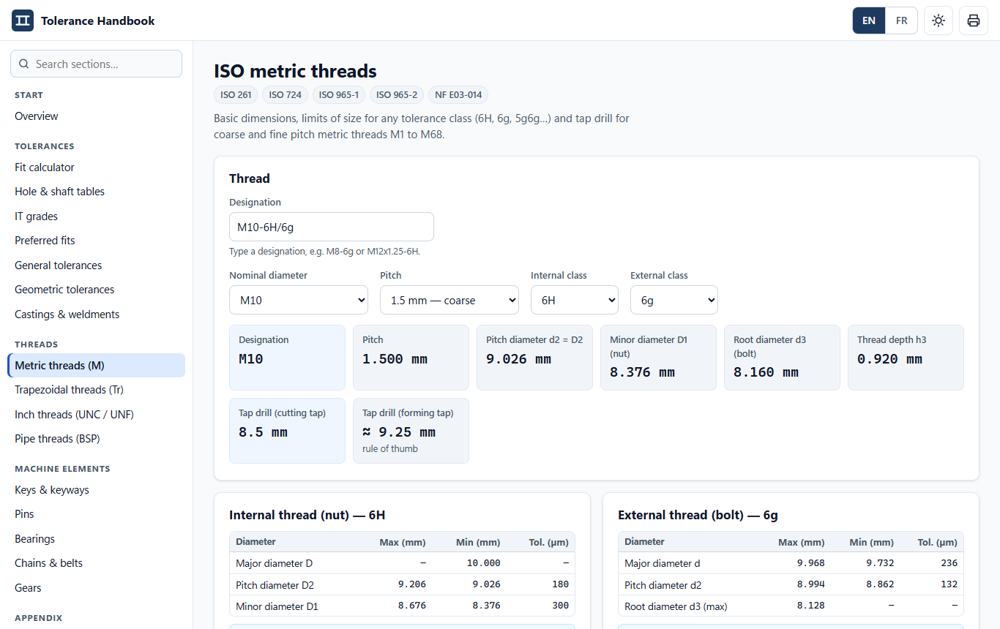
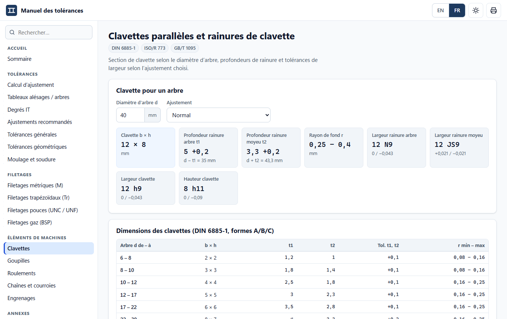
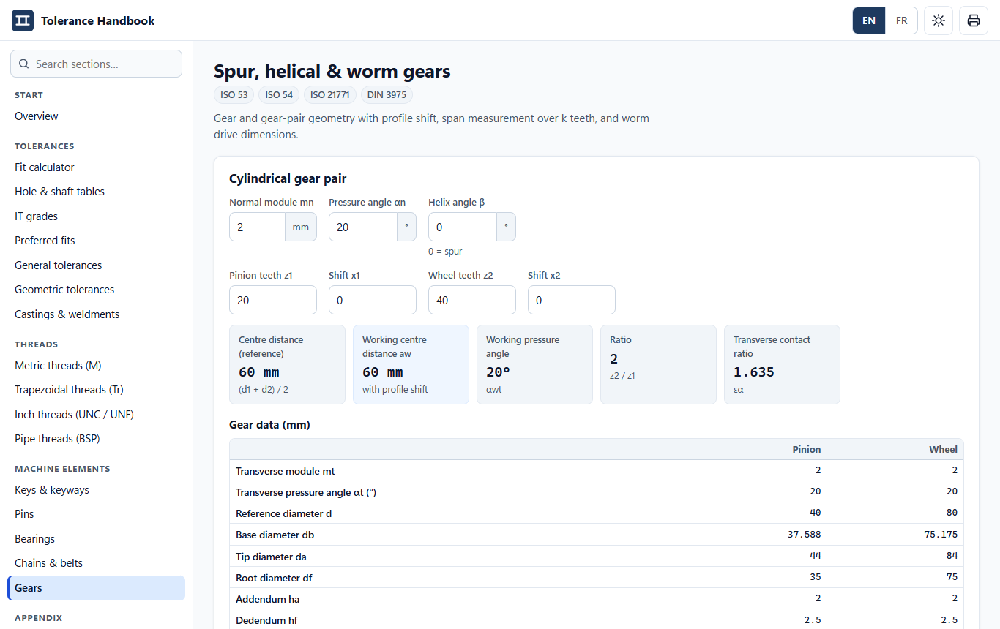
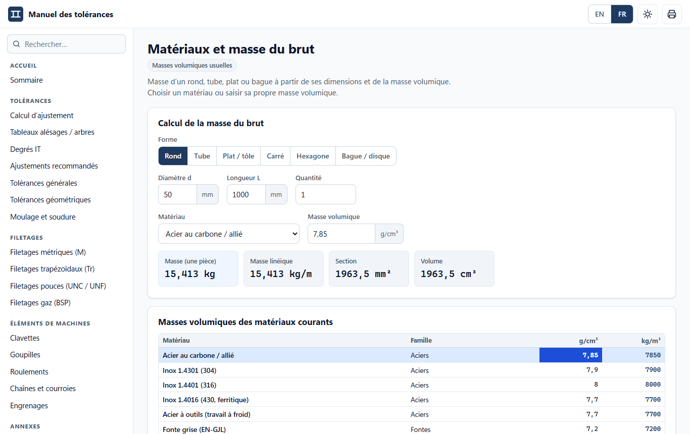
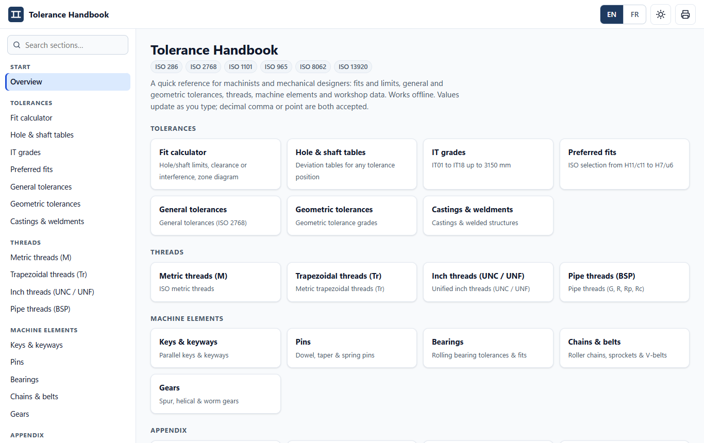

# Tolerance Handbook · Manuel des tolérances

An offline, bilingual (English / Français) engineering reference for machinists and mechanical designers: ISO fits, general and geometric tolerances, threads, machine elements and workshop data.

It is a modern rebuild of the Chinese *公差速查手册 9.0* ("Tolerance quick-reference handbook") desktop tool, rewritten from the ISO standards with calculators instead of static pictures, and usable on any computer or phone.



## Use it

**No installation.** Download the zip from the [Releases](../../releases) page, unzip it and double-click **`Tolerance Handbook.html`**. It opens in your browser and works with no internet connection. Keep the `css` and `js` folders next to the `.html` file.

- Switch **EN / FR** at the top right; French uses the decimal comma, and inputs accept both `,` and `.`.
- Press **/** to search the sections.
- Every result updates as you type; the looked-up row or cell is highlighted in the reference tables.
- Light and dark themes, print-friendly pages, works at phone width.

## What's inside

| Section | Pages |
|---|---|
| **Tolerances** | Fit calculator (ISO 286, with tolerance-zone diagram) · Hole & shaft limit tables (all positions a–zc / A–ZC, IT01–IT18, up to 3150 mm) · IT grades · Preferred fits · General tolerances ISO 2768-1/-2 · Geometric tolerance grades (form, orientation, location, runout) · Castings ISO 8062-3 and weldments ISO 13920 |
| **Threads** | ISO metric (ISO 261/965 limits) · Trapezoidal Tr · Unified UNC/UNF · Pipe threads G / R |
| **Machine elements** | Parallel keys & keyways (DIN 6885-1) · Dowel & other pins · Rolling bearings (ISO 492 + recommended fits) · Roller chains, sprockets & V-belts · Spur/helical gears and worm gears |
| **Appendix** | Clearance holes & counterbores · Tapers (Morse, steep 7:24, calculator) · Lifting eye bolts · Material densities & blank weight · Unit converter · Surface roughness |

## Screenshots

| | |
|---|---|
|  |  |
|  |  |
|  |  |
|  | |

## Accuracy

Values are computed from, or transcribed from, the cited ISO / DIN standards and cross-checked against published tables (see `tests/unit`). The ISO 286 engine derives every hole and shaft tolerance class from the shaft fundamental deviations and the rules of ISO 286-1 (Δ for K–ZC, JS rounding, the M6 special case) and is checked against 66 reference values from ISO 286-2. As with any handbook, check the current edition of the standard and your drawing requirements for contractual use.

## Development

Plain HTML, CSS and JavaScript — no build step, no dependencies, runs from `file://`.

```
index.html            app shell
css/app.css           design tokens, light/dark, print
js/core.js            i18n, DOM helpers, router, table/form components
js/engine/*.js        pure calculation engines and data (unit-tested, no DOM)
js/modules/*.js       one file per section, registers its pages
tests/unit/*.test.cjs engine tests (node --test)
tests/e2e/smoke.cjs   every page in EN and FR, phone and desktop, in real Chrome
tools/build.cjs       builds dist/ToleranceHandbook and the zip
```

```
npm test            # unit tests
npm run e2e         # browser smoke test (needs the playwright package and Chrome)
npm run build       # dist/ToleranceHandbook-<version>.zip
```
