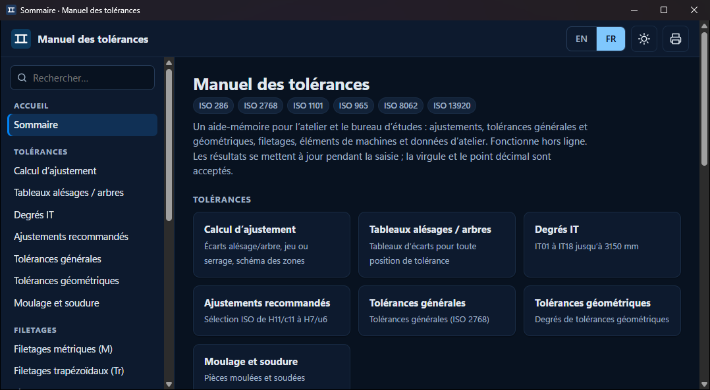

# Tolerance Handbook · Manuel des tolérances

An offline, bilingual (English / Français) engineering reference for machinists and mechanical designers: ISO fits, general and geometric tolerances, threads, machine elements and workshop data.

It is a modern rebuild of the Chinese *公差速查手册 9.0* ("Tolerance quick-reference handbook") desktop tool, rewritten from the ISO standards with calculators instead of static pictures, and usable on any computer or phone.


## Use it

### Windows app (recommended)

Download **`ToleranceHandbook.exe`** from the [latest release](../../releases/latest) and double-click it. It is one 1.4 MB file and needs no installation:

- it opens in its own window (remembers its size and position, **F11** = full screen, Ctrl + / Ctrl − = zoom);
- it works fully offline — the whole handbook is inside the exe;
- it runs on Windows 10 and 11 with nothing to install, using the .NET Framework 4.8 and Microsoft Edge WebView2 already built into Windows 11 (on an old Windows 10 without WebView2 it offers to download it, or to open the handbook in your browser instead);
- the title bar follows the light / dark theme.

Windows may show a SmartScreen notice the first time because the exe is not code-signed: choose *More info → Run anyway*.



### Any other system (Mac, Linux, tablet)

Download the release zip, unzip it and open **`Tolerance Handbook.html`** in a browser (keep the `css` and `js` folders next to it).

### Everywhere

- Switch **EN / FR** at the top right; French uses the decimal comma, and inputs accept both `,` and `.`.
- Press **/** to search the sections.
- Every result updates as you type; the looked-up row or cell is highlighted in the reference tables.
- Light and dark themes, print-friendly pages, works at phone width.

## What's new in 1.1

- **Native Windows app**: `ToleranceHandbook.exe`, a single self-contained file with its own window, icon, remembered window position, full screen and a title bar that follows the theme.
- The release zip now contains both the exe and the browser version.

## What's inside

| Section | Pages |
|---|---|
| **Tolerances** | Fit calculator (ISO 286, with tolerance-zone diagram) · Hole & shaft limit tables (all positions a–zc / A–ZC, IT01–IT18, up to 3150 mm) · IT grades · Preferred fits · General tolerances ISO 2768-1/-2 · Geometric tolerance grades (form, orientation, location, runout) · Castings ISO 8062-3 and weldments ISO 13920 |
| **Threads** | ISO metric (ISO 261/965 limits) · Trapezoidal Tr · Unified UNC/UNF · Pipe threads G / R |
| **Machine elements** | Parallel keys & keyways (DIN 6885-1) · Dowel & other pins · Rolling bearings (ISO 492 + recommended fits) · Roller chains, sprockets & V-belts · Spur/helical gears and worm gears |
| **Appendix** | Clearance holes & counterbores · Tapers (Morse, steep 7:24, calculator) · Lifting eye bolts · Material densities & blank weight · Unit converter · Surface roughness |

## Screenshots

| | |
|---|---|
|  |  |
|  |  |
|  |  |
|  | |

## Accuracy

Values are computed from, or transcribed from, the cited ISO / DIN standards and cross-checked against published tables (see `tests/unit`). The ISO 286 engine derives every hole and shaft tolerance class from the shaft fundamental deviations and the rules of ISO 286-1 (Δ for K–ZC, JS rounding, the M6 special case) and is checked against 66 reference values from ISO 286-2. As with any handbook, check the current edition of the standard and your drawing requirements for contractual use.

## Development

The handbook itself is plain HTML, CSS and JavaScript — no dependencies, runs from `file://`. The Windows app in `desktop/` is a small C# WinForms shell (.NET Framework 4.8) around Microsoft Edge WebView2: the web files, the WebView2 libraries and the native loaders are embedded in the exe, and the pages are served from the virtual origin `https://app.tolerance/`.

```
index.html            app shell
css/app.css           design tokens, light/dark, print
js/core.js            i18n, DOM helpers, router, table/form components
js/engine/*.js        pure calculation engines and data (unit-tested, no DOM)
js/modules/*.js       one file per section, registers its pages
tests/unit/*.test.cjs engine tests (node --test)
tests/e2e/smoke.cjs   every page in EN and FR, phone and desktop, in real Chrome
desktop/              Windows app (C# WinForms + WebView2) that embeds the web app
tools/build.cjs       builds dist/ToleranceHandbook.exe, dist/ToleranceHandbook/ and the zip
```

```
npm test            # unit tests
npm run e2e         # browser smoke test (needs the playwright package and Chrome)
npm run build       # exe + zip (needs the .NET SDK; add --no-exe for the web zip only)
```

The browser test can also drive the real desktop app: start the exe with `TOLERANCE_HANDBOOK_DEBUG=1` (opens a separate profile with a remote-debugging port, 9222 by default) and run `node tests/e2e/smoke.cjs --cdp http://127.0.0.1:9222`.
